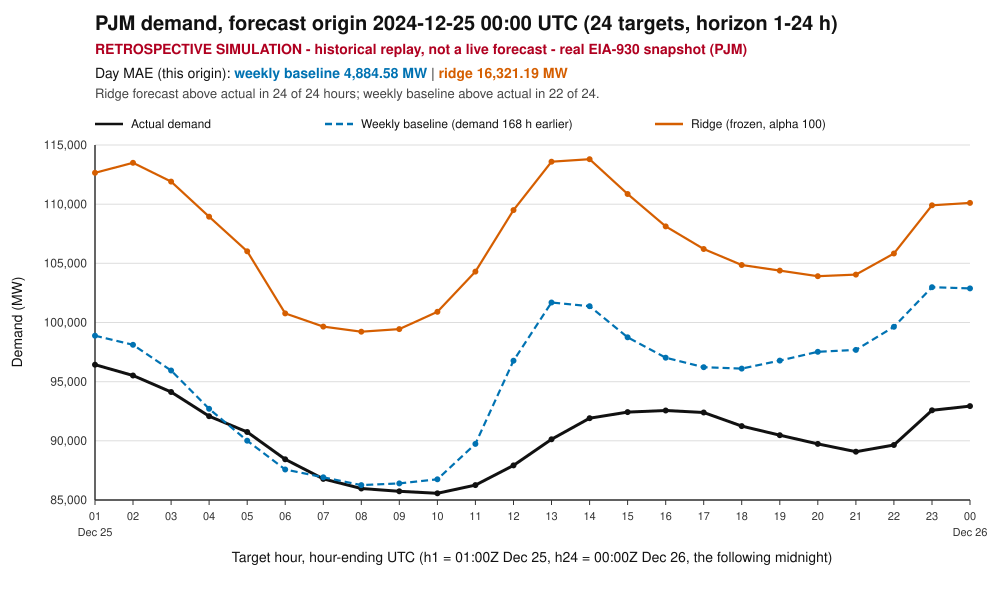

# PJM energy demand forecasting: weekly baseline vs one frozen ridge model

**RETROSPECTIVE SIMULATION.** Everything here is a historical replay on one fixed EIA-930 snapshot. It is
not a live forecast and not evidence of real-time performance. Python standard library only (plus `tzdata` on
Windows). Tested on Windows 11 with Python 3.12.5 and 3.13.7.

## Result on the shared scoring set

PJM, daily forecast origins 2024-11-01 .. 2024-12-31 at 00:00 UTC, 24 hourly targets each (horizon 1-24 h).
Both models are scored on the same **1,389 of 1,464 scheduled hours** (94.88%), the hours where the baseline
forecast, the ridge forecast and the actual all exist.

| model | MAE (MW) | RMSE (MW) |
|---|---:|---:|
| weekly baseline (demand 168 h earlier) | 7,800.40 | 10,615.49 |
| ridge (frozen, alpha 100) | 5,823.57 | 7,570.77 |

- Ridge MAE is 25.3% lower and RMSE 28.7% lower on these rows and it is lower at every horizon, but ridge has the
  smaller absolute error on only 829 of the 1,389 rows (the baseline is better on 560).
- 75 scheduled hours are not comparable: 25 with a blank 168 h lag, 25 with a blank 48 h lag, 25 with a blank
  target. (The baseline alone scores 1,414 hours, the CHECKPOINT2 figure; those numbers are not comparable with the
  table above.)
- **October tuning result (kept visible on purpose):** on the October tuning block (origins 2024-10-01 .. 10-30),
  the weekly baseline had the **lower** MAE: 3,710.91 MW against 4,343.40 MW for the ridge at the chosen alpha
  (model fit on July-September only). The tuning block did not predict the test-block advantage, and alpha was
  not re-tuned after the test result.

### Failure case: 2024-12-25



The 2024-12-25 00:00 UTC origin is the fully scored origin with the highest ridge MAE (55 of 61 origins are fully
scored): ridge MAE **16,321.19 MW** against **4,884.58 MW** for the weekly baseline. The chart shows all 24
targets, from 01:00Z on Dec 25 to horizon 24 at 00:00Z on Dec 26.

Ridge **overpredicted in all 24 hours**, by 12,323 to 23,456 MW. The weekly baseline was above the actual in 22
of 24 hours. **The cause of the miss was not established.** The model has no holiday feature and no explanation
was tested, so none is claimed here.

Regenerate the chart from `paired_predictions.csv` (after running the backtest below):

```powershell
.\.venv\Scripts\python.exe -m eia930.chart --predictions outputs\real\PJM\simulation\paired_predictions.csv --origin 2024-12-25T00:00:00Z --out docs\worst_day_2024-12-25.svg
```

The SVG is deterministic: regenerating it should leave `git diff --exit-code docs\worst_day_2024-12-25.svg` clean.

## Reproduce from a clean checkout (Windows PowerShell)

### 1. Environment

Python 3.12 or 3.13 and Git are required.

```powershell
git clone https://github.com/RyanJBush/pjm-demand-forecast.git
cd pjm-demand-forecast
python -m venv .venv
.\.venv\Scripts\python.exe -m pip install -r requirements-dev.txt
.\.venv\Scripts\python.exe -m pytest -q -rs
```

`requirements-dev.txt` installs `pytest` and `tzdata` (Windows has no built-in IANA time zone database). The last
command runs the synthetic tests; three opt-in real-snapshot checks are reported as skipped until you set
`EIA930_SNAPSHOT_CSV` (step 3).

### 2. Data

| item | value |
|---|---|
| Source (official EIA Grid Monitor six-month file) | https://www.eia.gov/electricity/gridmonitor/sixMonthFiles/EIA930_BALANCE_2024_Jul_Dec.csv |
| Snapshot filename | `EIA930_BALANCE_2024_Jul_Dec.csv` |
| Verified download date | November 8, 2026 |
| SHA-256 | `a602a8e577cfdd2fa3083413eaa4dd8ba7f0d2b26a2986f8f6d22917465ea49f` |
| Source publication date | **unverified** |

```powershell
$Csv = "$HOME\Downloads\EIA930_BALANCE_2024_Jul_Dec.csv"
Invoke-WebRequest -Uri "https://www.eia.gov/electricity/gridmonitor/sixMonthFiles/EIA930_BALANCE_2024_Jul_Dec.csv" -OutFile $Csv
(Get-FileHash $Csv -Algorithm SHA256).Hash
```

The printed hash must equal the SHA-256 above (PowerShell prints it in upper case). EIA may revise or replace the
file; a different hash means a different snapshot, and the backtest, run with `--expect-sha256`, refuses to run on it.

### 3. Run the backtest

```powershell
$Csv = "$HOME\Downloads\EIA930_BALANCE_2024_Jul_Dec.csv"
.\.venv\Scripts\python.exe -m eia930.simulate --csv $Csv --ba PJM --data-label real `
    --expect-sha256 a602a8e577cfdd2fa3083413eaa4dd8ba7f0d2b26a2986f8f6d22917465ea49f `
    --expect-common-rows 1389
```

It takes a few seconds, exits 0, and should print (among other lines):

```
chosen alpha: 100   frozen digest: aedcc23811b60e9fac5ab10bbcac49acfe0384a73d7adf74b679764a6db0bf4b
test: scheduled 1464  baseline scored (own) 1414  common rows 1389  expected 1389  lags after cutoff 0
  baseline MAE 7,800.40 MW   RMSE 10,615.49 MW   (n=1389)
  ridge    MAE 5,823.57 MW   RMSE 7,570.77 MW   (n=1389)
```

The frozen digest was identical on Python 3.12.5 and 3.13.7 (Windows) and matches CHECKPOINT3. Run the opt-in
real-snapshot checks (digest, counts, metrics, October result, chart reproducibility):

```powershell
$env:EIA930_SNAPSHOT_CSV = $Csv
.\.venv\Scripts\python.exe -m pytest -q -rs
```

### 4. Output files

All under `outputs\real\PJM\simulation\` (git-ignored). Every file is stamped `retrospective_simulation` and the
data label `real`.

| file | contents |
|---|---|
| `report.md` | paired report: tuning table, coverage and skip reasons, overall and per-horizon MAE/RMSE, highest-MAE fully scored day |
| `summary.json` | all numbers in the report, the frozen digest, the periods and the checksum |
| `paired_predictions.csv` | one row per scheduled hour (1,464): origin, cutoff, target, horizon, both lags, baseline and ridge forecasts, actual, common-set flag, reason |
| `validation.csv` | tuning MAE for each alpha in the grid |
| `frozen_model.json` | the frozen ridge parameters and their SHA-256 digest |

`docs\worst_day_2024-12-25.svg` is the committed failure-case chart.

**Publication is the last step and is all-or-nothing.** Each invocation builds the complete five-file set in its own
staging directory (`.simulation.staging-<random>`, next to the output directory) and moves it into place only after
every check has passed: checksum, fit, tune, freeze, scoring, zero-common-rows and `--expect-common-rows`. Any failure
before that point (exit 1 or 2), including a row-count mismatch, leaves an existing output set byte-for-byte untouched.
If publishing itself fails partway, the files already moved in are removed and the previous ones are moved back; if
that rollback also fails, the previous files stay in the retained staging directory and the error names it. Do not run
two invocations that publish to the same output directory at the same time: their staging is isolated, but their
final moves are not coordinated.

## Method

- **Splits (chronological, by forecast origin):** fit 2024-07-09 .. 09-29 (1,992 usable rows); tune 2024-10-01 ..
  10-30 (720 rows); test 2024-11-01 .. 12-31. Alpha was chosen from 0.001 .. 10000 by MAE on the tune block with the
  model fit on the fit block only (alpha 100), then the model was refit on fit + tune and frozen.
- **Freeze:** the model was frozen before test cases were constructed or scored. The CLI loads the full CSV into
  memory up front, so test rows are in memory before the freeze; before it the code only checksums and parses the
  file and takes the earliest timestamp, and a test checks that no test-period timestamp is looked up before the
  freeze.
- **Ridge features:** demand 48 h and 168 h before the target, forecast horizon (1-24), and hour-of-day and
  day-of-week of the target interval's **start** in America/New_York. The CSV's hour-ending labels are stamped as
  UTC, shifted back one hour to the interval start, then converted to Eastern time.
- **Cutoff:** each origin has a shared cutoff of origin minus 2 hours. Every lag source must be at or before it.
- **Forecasts do not depend on actuals:** a forecast exists whenever its lags are usable, whether or not the actual
  exists. A row is scored only if both forecasts and the actual exist.
- **Weekly baseline:** the forecast for hour t is demand at t - 168 h. Error is forecast minus actual.

## Assumptions and limitations

- **The two-hour publication delay is assumed**, so the cutoff definition is too. At horizons 1-24 neither lag can
  reach the cutoff at the default delay.
- **The snapshot may contain revised observations.** A real-time forecast would have used values as first
  published, so real-time errors can differ.
- **The source publication date of the snapshot is unverified.** The download date and hash are verified.
- The target is the raw `Demand (MW)` column; blank values are not imputed or adjusted.
- One balancing authority, one two-month test block, alpha tuned on one month of data. No holiday or weather
  features. The result says nothing about other regions, seasons or live operation.
- The baseline beat the ridge on the October tuning block and the cause of the Dec 25 miss is not established, so
  the test-block gain should be read with caution.
- Results are verified on Windows 11 only (Python 3.12.5 and 3.13.7). No hosted CI is configured for this project.

## Exit codes

| command | 0 | 1 | 2 |
|---|---|---|---|
| `eia930.simulate` | ran and matched expectations | `--expect-common-rows` mismatch, or **no test hour could be scored for both forecasts** (a diagnostic is printed; nothing is published, and an existing output set in the same directory is left untouched) | input error (missing file or column, unknown BA, duplicate UTC keys, checksum mismatch, bad arguments) |
| `eia930.chart` | chart written | | bad input (missing file, origin not fully scored) |
| `eia930` (baseline only) | scored rows | nothing scored | input error |

## Baseline-only command

`python -m eia930 --csv <csv> --ba PJM --data-label real --origin-start 2024-11-01 --origin-end 2024-12-31`
runs just the 168-hour baseline on the daily-origin schedule (1,464 scheduled, 1,414 scored for PJM) and writes
`forecasts.csv`, `ingest_skipped.csv` and `summary.json` under `outputs\real\PJM\`.

## Layout

`eia930/ingest.py` CSV ingestion and duplicate-key check; `eia930/baseline.py` schedule and weekly baseline;
`eia930/ridge.py` ridge model and time-zone features; `eia930/simulate.py` the backtest and paired report;
`eia930/chart.py` the failure-case chart; `tests/` synthetic fixtures and tests; `docs/` the committed chart.
